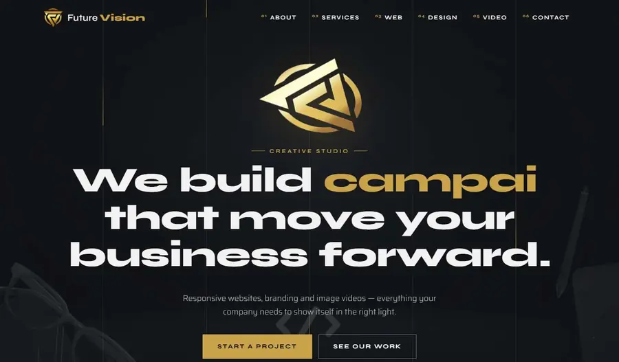

# Creative studio template — Future Vision

Dark creative agency template: intro loader, circular full-screen menu with 3D tilt-in links, custom cursor, typing headline, magnetic buttons. Plain HTML/CSS/JS.

**Live demo:** https://abdelmoulabilel.github.io/creative-agency-template/

## Use it
- Click **Use this template** on GitHub (or download the ZIP), then open `index.html` — no install, no build.
- Publish for free: repo **Settings → Pages → Deploy from branch → main / root**.

## Customise
Text in `index.html`, colours in `css/style.css` (`:root`), contact email and typed words in `js/main.js` (`CONTACT_EMAIL`, `WORDS`).
The intro loader shows once per visit (click it or wait 2.6 s). Remove the `#intro` block in `index.html` to turn it off.

## Credits
Code: MIT licence (see `LICENSE`). Photos come from earlier client projects or theme demos and are for demonstration only — replace them with your own images.
